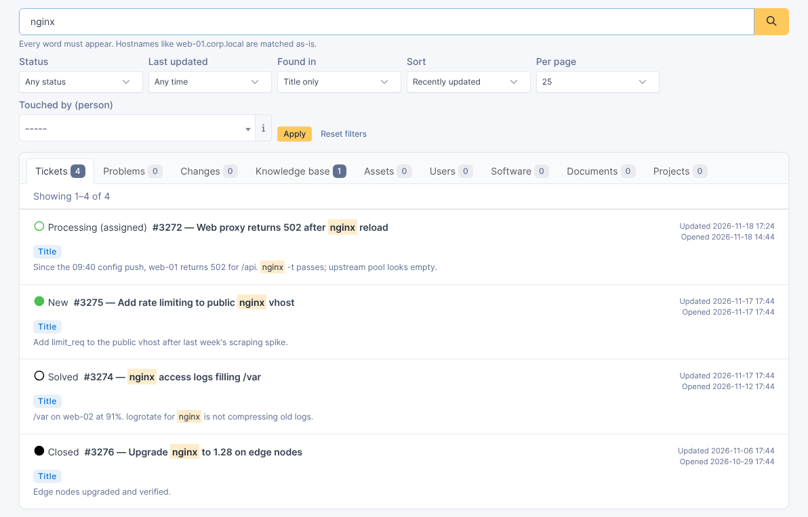
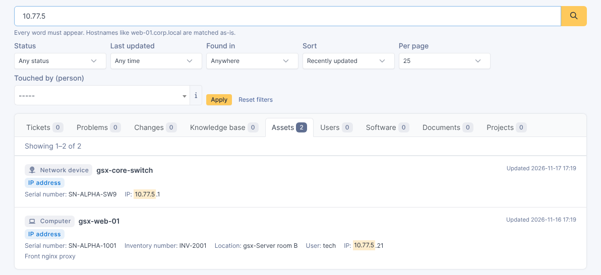

# OmniSearch for GLPI

> Formerly **Global Search**. Renamed in v0.5.0 because the plugin key `globalsearch` already belongs to another plugin in the GLPI catalog. See [Upgrading from Global Search](#upgrading-from-global-search).

Replaces the top search bar with one search across:

- Tickets, Problems, Changes: title, description, followups, tasks
- Knowledge base: article title and content
- Assets (computers, network devices, printers, phones, monitors, peripherals): name, serial, inventory number, alternate username, comments, **IP address** and **MAC address** (`aa:bb:..` or `AA-BB-..`)
- Users: login, first and last name, email, phone / mobile, administrative (employee) number
- Software: name and comments
- Documents: name, file name and comments
- Projects: name, code, description and comments

Results are grouped into tabs by type (with counts), with the matched field and a highlighted snippet.

## Features

- **Status at a glance**: every ticket, problem and change shows GLPI's own colored status icon and name (New, Processing, Pending, Solved, Closed…). Closed and solved items are included in searches.
- **Filters**: status (open / pending / solved / closed / solved or closed), last updated (7 / 30 / 90 days, 12 months or a custom date range), where the words were found (title, description, followups, tasks), sort order and page size. Filters apply as soon as you change them.
- **Search by person**: pick a user in *Touched by* to list everything they touched: requester, observer or assigned, opened it, last updated it, or wrote a followup, task or solution (and KB articles they wrote). Combine it with words to narrow it down. Typing a name or login in the search box also suggests matching people.
- **Pagination**: every result is reachable, page by page (25, 50 or 100 per page).
- **Asset and user details at a glance**: type icon, serial and inventory numbers, status, location, user, IP addresses; for users their email, phones and an *Inactive* flag.
- **Touched by** also lists assets and software a person uses or is technician for, documents they uploaded, and projects they manage or are on the team of.

## Compatibility

One download works on all supported GLPI versions:

| GLPI | Status |
| --- | --- |
| 10.0.x | Supported (tested on 10.0.28) |
| 11.0.x | Supported (tested on 11.0.11) |
| 12.0.x | Supported (tested on 12.0.0) |

Requires PHP 8.1 or newer.

## Permissions

Results go through GLPI's own `canViewItem()` checks for each item. That means the plugin respects:

- entities
- "see all / see my group's / see my own" ticket rights
- private followups and tasks
- KB visibility targets
- assets and software: the type's read right and your active entities (trashed items and templates are never shown)
- users, documents and projects: GLPI's own per-item checks

Only users with the standard (central) interface get the plugin. Self-service users keep the normal search.

## Install

1. Download the latest release archive and unpack it into `<glpi>/plugins/`, so the folder is `<glpi>/plugins/omnisearch` (the folder name must be `omnisearch`). Or clone it:
   `git clone https://github.com/mebessusn/glpi-omnisearch.git omnisearch`
2. Run `bin/console plugin:install omnisearch` and then `bin/console plugin:activate omnisearch`, or use Setup → Plugins.
3. Hard-refresh the browser.

## Upgrading from Global Search

Versions up to 0.4.0 were called **Global Search** (folder `globalsearch`). The plugin stores no data, so switching is safe:

1. In **Setup → Plugins**, disable and uninstall **Global Search**, then delete the `plugins/globalsearch` folder. If it still shows in the plugin list, click **Clean** next to it.
2. Install OmniSearch as above (folder `plugins/omnisearch`).
3. Hard-refresh the browser.

Don't keep both installed: both would take over the top search bar.

## Search rules

- The query is split on spaces, and every word must appear in the item.
- Words shorter than 2 characters are ignored. At most 6 words are used.
- Hostnames, IPs and paths are matched as typed. For example, `web-01.corp.local` works.
- It searches with LIKE, not the MySQL full-text index, so there is no minimum word length or stopword problem.
- Up to 5,000 matches per type are listed (a notice tells you when there are more; add words or filters).
- Trashed (deleted) items are not shown. Status and followup/task filters don't apply to KB articles.

## Permissions and speed

Results go through GLPI's own visibility rules. Users with "see all" rights on a type get results in well under a second, even with thousands of matches. Users without it get each match checked with GLPI's own `canViewItem()`, so a search matching thousands of items can take a few seconds for them.

## Performance

LIKE '%term%' scans the whole table, which is fine up to a few hundred thousand tickets and followups. If it gets slow, the next step is a FULLTEXT index plus MATCH ... AGAINST, or an external index.

## License

GPLv3 or later. See `LICENSE`.
